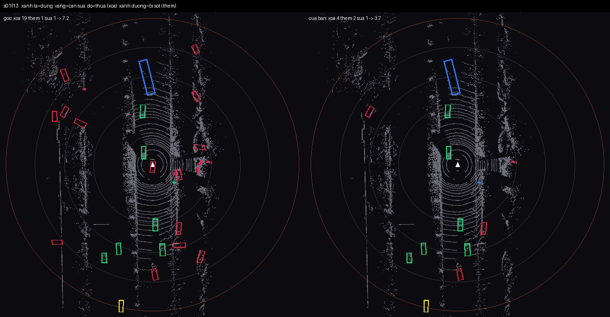

# Báo cáo Day 14 — Nguyễn Quang Tùng — 2A202603080

- Mã học viên dùng với `--student`: `2A202603080`
- `seed_tag` trong `frames_A.txt`: `cb0f42154c`

## 1. Dự đoán trước sweep (bước 5b)

- Tham số tôi nghĩ giảm công sửa nhiều nhất: **`score_thr`** (tăng ngưỡng điểm tin cậy từ mức gốc `0.1` lên khoảng `0.3–0.4`), kết hợp với **`min_points`** (ví dụ `5`) để loại bỏ các hộp dự đoán có quá ít điểm LiDAR.
- Vì sao (nhìn ảnh BEV tập A: box thừa nhiều hay box sót nhiều?):
  - Quan sát 3 ảnh tổng hợp camera + BEV trong `png_A/` (`s01f13`, `s03f55`, `s04f41`) và số đo cấu hình gốc trên tập A, **box thừa (false positive) nhiều áp đảo so với box sót**: mô hình tạo ra nhiều hộp nhiễu điểm thấp ở hàng cây, bụi rậm, rào chắn, dải phân cách và biển báo/trạm xe buýt (cụ thể ở lượt đo gốc trên 3 frame tập A: 59 hộp thừa phải xóa, chiếm `59 × 0.3 = 17.7` điểm trong tổng `21.7` điểm chi phí, trong khi chỉ có 3 xe Bus bị sót = `3.0` điểm và 2 hộp cần sửa = `1.0` điểm).
  - Các vật thể bị bỏ sót chủ yếu là xe `Bus` (lớp mà trọng số KITTI chưa được huấn luyện trực tiếp) nên việc đổi `score_thr` hay `min_points` không thể tự tìm thêm xe Bus, nhưng tăng `score_thr` (và `min_points`) sẽ cắt được lượng lớn hộp nhiễu điểm thấp.
  - Tuy nhiên cần giữ ngưỡng ở mức vừa phải (không đặt quá cao như `0.5` trở lên) vì chi phí thêm 1 vật bị sót (`1.0`) nặng gấp hơn 3 lần xóa 1 hộp thừa (`0.3`), nếu lọc quá tay làm mất các xe ở xa hoặc `Pedestrian`/`Cyclist` thì tổng chi phí sẽ tăng ngược trở lại.

## 2. Tập A: sửa tay và tune

| Cấu hình | Xóa | Thêm | Sửa | Chi phí |
|---|---:|---:|---:|---:|
| Gốc | 59 | 3 | 2 | 21.7 |
| `best_config.json` | 11 | 4 | 2 | 8.3 |

- Tham số đã đổi trong `best_config.json`: `score_thr: 0.1 -> 0.5` (`min_points` giữ nguyên `0`; khi `score_thr >= 0.4` thì `min_points = 0, 5, 10` đều cho cùng chi phí).
- Kết quả leave-one-out (dán các dòng `scripts/pp_sweep.py` in ra):
  ```text
  Leave-one-out (chọn trên các frame còn lại, chấm trên frame bỏ ra):
    s01f13: cấu hình chọn {'score_thr': '0.5', 'min_points': '0'} → 3.7 (tốt nhất có thể 3.7)
    s03f55: cấu hình chọn {'score_thr': '0.5', 'min_points': '0'} → 3.8 (tốt nhất có thể 3.8)
    s04f41: cấu hình chọn {'score_thr': '0.5', 'min_points': '0'} → 0.8 (tốt nhất có thể 0.8)
  ```
- Cấu hình có ổn định trên từng frame không? Vì sao tôi vẫn chọn (hoặc không chọn) nó:
  - Trên cả 3 frame tập A, cấu hình rất ổn định: cả 3 lượt leave-one-out đều tự chọn đúng `{'score_thr': '0.5', 'min_points': '0'}` và đạt đúng bằng mức chi phí tốt nhất có thể (`oracle`) của từng frame (`3.7`, `3.8`, `0.8`), đồng thời giảm mạnh chi phí ở tất cả các frame so với gốc (`7.2 → 3.7`, `11.6 → 3.8`, `2.9 → 0.8`).
  - Vì vậy tôi chọn `best_config.json` (`score_thr=0.5, min_points=0`) để chạy pre-label cho tập B, đồng thời lưu ý kiểm tra kỹ các vật thể nhỏ (`Pedestrian`, `Cyclist`) hoặc xe ở xa khi tự kiểm trên CVAT vì ngưỡng `0.5` có thể lọc mất một số vật điểm tin cậy thấp.

## 3. Trước/sau (bước 8)



- `scripts/pp_compare.py` báo giảm **62%** công sửa trên tập A (tổng chi phí giảm từ `21.7` xuống `8.3` trên 3 frame).
- Dự đoán ở mục 1 đúng hay sai? Giải thích bằng số box xóa/thêm/sửa:
  - **Đúng ở nhận định chính:** Đúng là tăng `score_thr` là tham số giảm công sửa nhiều nhất nhờ cắt mạnh lượng box thừa từ `59` xuống `11` (bớt `48` hộp thừa, giảm `48 × 0.3 = 14.4` điểm chi phí).
  - **Lệch một phần ở mức ngưỡng và vai trò của `min_points`:** Ở bước 5b tôi đoán mức tốt nhất nằm quanh `0.3–0.4` kết hợp `min_points=5` vì lo ngưỡng `0.5` sẽ bỏ sót nhiều vật thật. Thực tế trên tập A, `score_thr=0.5` lại đạt chi phí thấp nhất (`8.3`, thấp hơn mức `0.4` là `10.7` và `0.3` là `16.7`): số hộp phải **thêm** chỉ tăng đúng `1` (từ `3` lên `4`, tốn thêm `+1.0` điểm do mất 1 hộp `Pedestrian` điểm thấp ở `s01f13`, thấy rõ chấm xanh dương bên phải xe trên ảnh so sánh `s01f13.jpg`), trong khi số hộp phải **xóa** giảm thêm tới `48` hộp so với gốc (và giảm `8` hộp so với mức `0.4`). Số hộp phải **sửa** giữ nguyên là `2`. Ngoài ra, `min_points` (`0, 5, 10`) không tạo thêm thay đổi nào khi `score_thr >= 0.4` vì các hộp rất ít điểm vốn đã có điểm tin cậy thấp và bị `score_thr` lọc trước.

## 4. Tập B

Số đo từ `scripts/pp_prelabel.py --data Data-VF --frames d14_2A202603080/frames_B.txt --config d14_2A202603080/best_config.json --gt d14_2A202603080/ref_B.json`:

| Xóa | Thêm | Sửa | Chi phí |
|---:|---:|---:|---:|
| 28 | 29 | 6 | 40.4 |

*(Tổng trên 12 frame trong bán kính 50 m: GT `155`, dự đoán `154`, khớp `126`, chi phí trung bình `3.37`/frame).*

- Loại box tốn công sửa nhất ở tập B:
  - Về thao tác, **thêm hộp bị bỏ sót** chiếm áp đảo chi phí (**29 hộp = 29.0 / 40.4 điểm**, tương đương ~72% tổng chi phí), cao hơn nhiều so với xóa hộp thừa (`28 hộp = 8.4 điểm`, gồm 19 `Car` và 9 `Cyclist`) và chỉnh sửa (`6 hộp = 3.0 điểm`, gồm 5 `Car` lệch kích thước/tâm và 1 `Car` phải đổi lớp sang `Truck`).
  - Xét theo lớp đối tượng, tốn công nhất là **các vật thể nhỏ bị bỏ sót** gồm **`Pedestrian` (11 hộp = 11.0 điểm)** và **`Cyclist` (9 hộp = 9.0 điểm)** — riêng hai lớp này đã chiếm `20.0 / 40.4` điểm. Nguyên nhân chính là cấu hình `score_thr = 0.5` được chọn từ tập A (vốn có rất ít người đi bộ và xe hai bánh) lọc hơi chặt đối với hai lớp có ít điểm LiDAR và điểm tin cậy thấp này (model chỉ giữ lại 1 `Pedestrian` trên toàn bộ 12 frame). Tiếp theo là **`Car` bị sót (6 hộp = 6.0 điểm)** và các xe cỡ lớn mà model KITTI chưa được huấn luyện trực tiếp là **`Bus` (2 hộp = 2.0 điểm)** và **`Truck` (1 hộp thêm + 1 hộp đổi lớp = 1.5 điểm)**.

## 5. Giới hạn

- **Tập tune quá nhỏ (chỉ 3 frame) và dùng chung một ngưỡng `score_thr` cho mọi lớp:** 3 frame tập A có rất ít `Pedestrian` và `Cyclist` nhưng nhiều box nhiễu, nên sweep chọn ngưỡng `score_thr = 0.5` (mức cao nhất trong lưới). Khi áp dụng sang 12 frame tập B có nhiều `Pedestrian`/`Cyclist` hơn, ngưỡng chung `0.5` làm bỏ sót nhiều vật nhỏ (`11 Pedestrian`, `9 Cyclist`), kéo chi phí trung bình tăng từ `2.77`/frame ở tập A lên `3.37`/frame ở tập B. Nếu tách ngưỡng riêng theo lớp (`thr_car`, `thr_cyc`, `thr_ped`) trên tập tune lớn hơn, khả năng cân bằng sẽ tốt hơn.
- **Lệch miền dữ liệu (domain shift) từ model KITTI pre-trained:** Trọng số PointPillars huấn luyện trên KITTI chỉ có 3 lớp (`Car`, `Cyclist`, `Pedestrian`), không học trực tiếp `Truck` và `Bus`, đồng thời khác biệt cảm biến và cảnh quan đô thị VF vẫn tạo ra hộp nhiễu ở cây cối/rào chắn và bỏ sót xe ở xa hoặc vật nhỏ.
- **Công thức `correction_cost` chỉ là thước đo gần đúng, chưa phải thời gian sửa thật:** Trọng số cố định `0.3·xóa + 1.0·thêm + 0.5·sửa` trong bán kính `50 m` không phản ánh sự khác nhau về công sức thực tế giữa việc vẽ mới một xe `Bus`/`Truck` lớn bị che khuất so với một `Pedestrian`, cũng như chưa tính thời gian annotator phải rà kiểm lại toàn bộ 126 hộp `khớp` trên 7 camera và 3 mặt cắt Top/Side/Front.
- **Sai số chủ quan từ nhãn tự kiểm:** `ref_A.json` và `ref_B.json` do một người tự đối chiếu camera và point cloud, nên vẫn có thể có sai số nhỏ ở các vật thưa điểm hoặc sát ngưỡng `50 m`.
